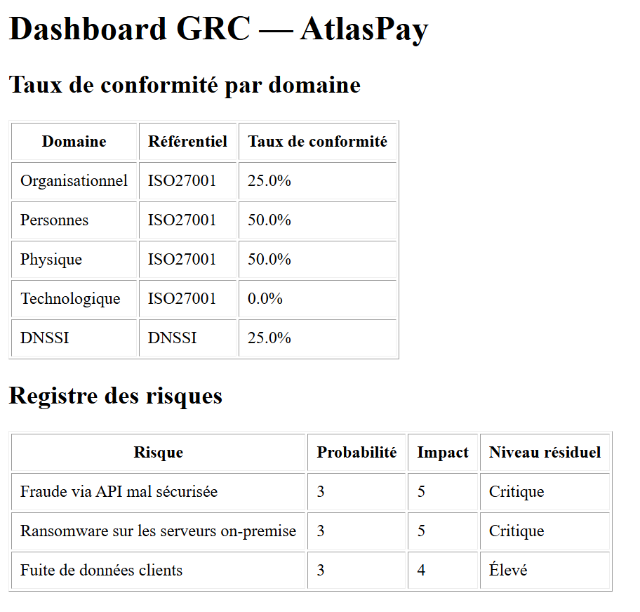
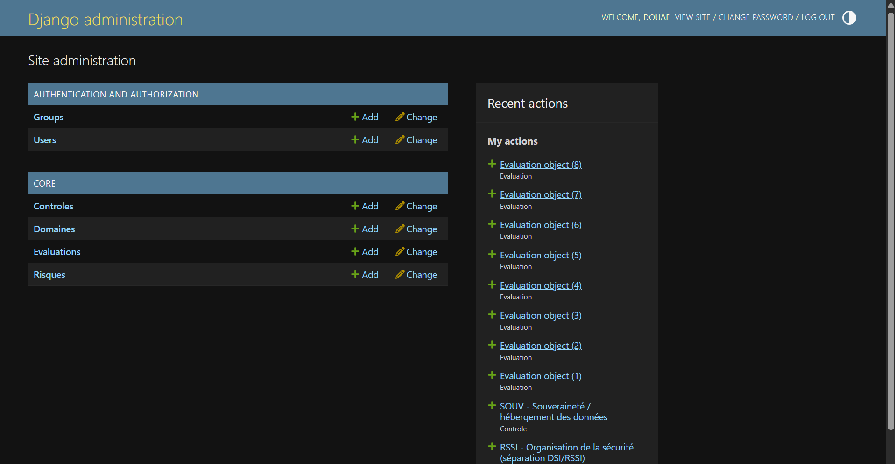
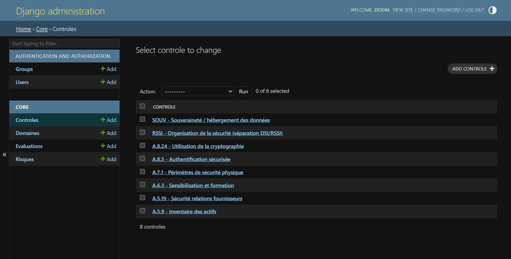
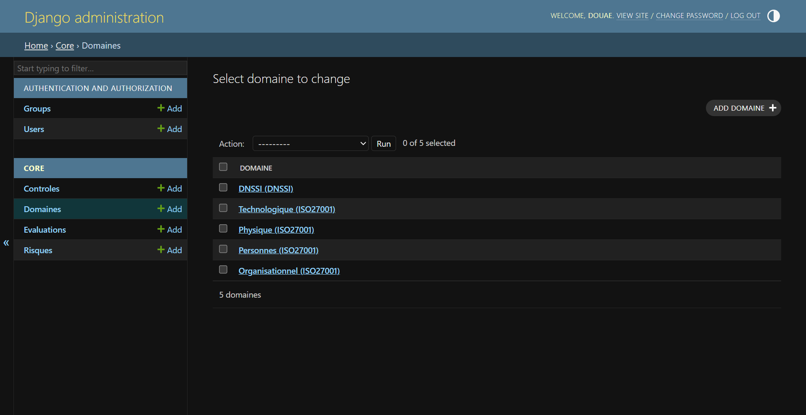
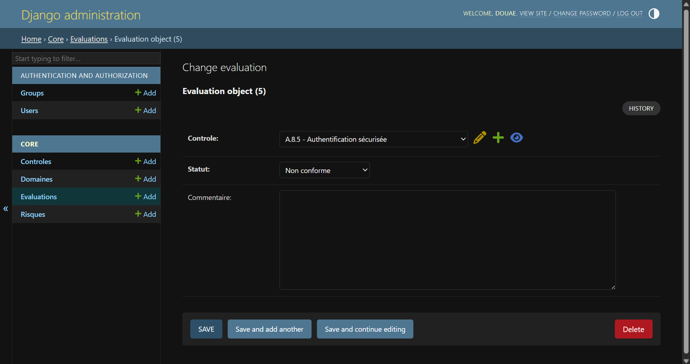

# GRC Compliance Tool — ISO/IEC 27001:2022 & DNSSI

A lightweight **Governance, Risk & Compliance (GRC)** web application built with Django.
It tracks the compliance status of security controls from **ISO/IEC 27001:2022 Annex A** and the
Moroccan **DNSSI** (Directive Nationale de la Sécurité des Systèmes d'Information), computes a
**compliance rate per domain**, and maintains a **risk register** scored on a probability × impact matrix.

The demo case is **AtlasPay**, a fictional Moroccan fintech.



📄 **Full project documentation:** [`docs/GRC_Tool_Documentation.pdf`](docs/GRC_Tool_Documentation.pdf)

---

## Features

| Feature | Description |
|---|---|
| Control catalogue | Controls grouped by domain and framework (ISO 27001 themes + DNSSI) |
| Compliance assessments | Each control is assessed as *Conforme*, *Partiellement conforme*, *Non conforme* or *Non applicable* |
| Compliance rate | Weighted score per domain (1 / 0.5 / 0; N/A excluded) |
| Risk register | Risks scored P × I (1–5 each) and classified *Faible / Moyen / Élevé / Critique* |
| Risk ↔ control mapping | Each risk is linked to the controls that mitigate it |
| Dashboard | Single page summarising compliance by domain and the risk register, colour-coded by level |
| Admin back-office | Full CRUD through the Django admin |

## Tech stack

Python 3.12+ · Django 6.0 · SQLite · Django templates

## Project structure

```
grc-compliance-tool/
├── manage.py
├── requirements.txt
├── .env.example
├── grc_project/            # Django project (settings, URLs, WSGI/ASGI)
├── core/                   # GRC application
│   ├── models.py           # Domaine, Controle, Evaluation, Risque
│   ├── views.py            # home, dashboard, add evaluation, add risk
│   ├── forms.py            # ModelForms
│   ├── admin.py
│   ├── tests.py            # unit + view tests
│   ├── templates/          # base layout + pages
│   ├── static/core/style.css
│   ├── migrations/
│   └── management/commands/seed_demo.py   # AtlasPay demo dataset
└── docs/
    ├── GRC_Tool_Documentation.pdf
    ├── latex/              # LaTeX source of the documentation
    └── screenshots/
```

## Getting started

```bash
git clone https://github.com/Dorvae/grc-compliance-tool.git
cd grc-compliance-tool

python -m venv venv
# Windows:  venv\Scripts\activate
# Linux/macOS:  source venv/bin/activate

pip install -r requirements.txt
python manage.py migrate
python manage.py seed_demo          # optional: loads the AtlasPay demo data
python manage.py createsuperuser    # to access /admin/
python manage.py runserver
```

| URL | Page |
|---|---|
| `http://127.0.0.1:8000/` | Home |
| `http://127.0.0.1:8000/dashboard/` | GRC dashboard |
| `http://127.0.0.1:8000/evaluations/ajouter/` | Add an assessment |
| `http://127.0.0.1:8000/risques/ajouter/` | Add a risk |
| `http://127.0.0.1:8000/admin/` | Administration |

Run the tests:

```bash
python manage.py test
```

## Scoring logic

**Compliance rate per domain**

```
rate = Σ points(status) / number of applicable assessments × 100
points: conforme = 1 · partiel = 0.5 · non_conforme = 0 · na = excluded
```

**Risk level** (score = probability × impact, each on 1–5)

| Score | Level |
|---|---|
| ≥ 15 | Critique |
| 9 – 14 | Élevé |
| 4 – 8 | Moyen |
| 1 – 3 | Faible |

## Demo results (AtlasPay)

| Domain | Framework | Compliance |
|---|---|---|
| Organisationnel | ISO 27001 | 25.0 % |
| Personnes | ISO 27001 | 50.0 % |
| Physique | ISO 27001 | 50.0 % |
| Technologique | ISO 27001 | 0.0 % |
| DNSSI | DNSSI | 25.0 % |

| Risk | P | I | Level |
|---|---|---|---|
| Fraude via API mal sécurisée | 3 | 5 | Critique |
| Ransomware sur les serveurs on-premise | 3 | 5 | Critique |
| Fuite de données clients | 3 | 4 | Élevé |

## Screenshots

| | |
|---|---|
|  |  |
|  |  |

## Security notes

- The secret key, debug mode and allowed hosts are read from environment variables (see `.env.example`).
  The default values are for **local development only**.
- The custom pages (`/dashboard/`, add forms) are not yet behind authentication — see the roadmap.

## Roadmap

- Require login on all custom views (`@login_required`) and role-based permissions
- Compute residual risk from the effectiveness of linked controls (currently the level is the inherent P × I score)
- Assessment history and compliance trend over time
- Charts, PDF/Excel export of the Statement of Applicability
- Full ISO 27001:2022 Annex A catalogue (93 controls) and DNSSI import

## Author

**Douae Admi** — Cybersecurity engineering student · [GitHub @Dorvae](https://github.com/Dorvae)

## License

MIT — see [LICENSE](LICENSE).
